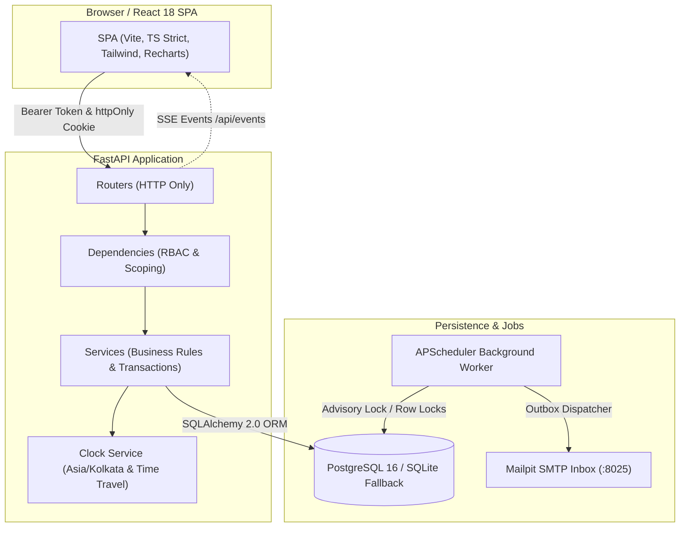

# Brightloop: Enterprise Subscription Management Platform

[](https://github.com/brightloop/brightloop)
[](https://www.python.org/)
[](https://fastapi.tiangolo.com/)
[](https://react.dev/)
[](https://www.typescriptlang.org/)
[](https://www.postgresql.org/)

Brightloop is a production-hardened subscription lifecycle, recurring billing, and revenue operations platform engineered for the **Odoo Hackathon**. Built with Python 3.12, FastAPI, SQLAlchemy 2.0, PostgreSQL (with automatic zero-config SQLite fallback), and a React 18 TypeScript SPA.

---

## ⚡ 5-Command Quickstart

Get Brightloop running locally in under 60 seconds without cloud dependencies:

```bash
# 1. Clone & enter workspace
git clone https://github.com/brightloop/brightloop.git && cd brightloop

# 2. Setup backend virtualenv & install dependencies
cd backend
python -m venv .venv && .venv/bin/activate  # Windows: .venv\Scripts\activate
pip install -r requirements.txt

# 3. Run database migrations & seed deterministic demo data
alembic upgrade head
python -m app.seed --full

# 4. Start backend API & scheduled worker (single process mode)
EMBEDDED_WORKER=true uvicorn app.main:app --host 0.0.0.0 --port 8000 --reload

# 5. In a second terminal: Start frontend React SPA
cd ../frontend
npm install
npm run dev
```

Visit the application at **`http://localhost:5173`** and the local email inbox at **`http://localhost:8025`** (or in Mailpit docker).

---

## 🔑 Pre-Seeded Demo Credentials

The login screen provides **one-click demo fill buttons** for instant evaluation:

| Role | Email | Password | Access Capabilities |
|---|---|---|---|
| **Platform Admin** | `admin@brightloop.test` | `Admin@12345` | Full access, user management, audit logs, outbox queue |
| **Operations Staff** | `staff1@brightloop.test` | `Staff@12345` | Subscriptions, catalog, billing runs, payments, invoices |
| **Subscriber Customer** | `customer@brightloop.test` | `Customer@12345` | Dedicated Customer Portal, self-service pause/close, invoice printing |

---

## 🎯 Problem-to-Feature Mapping

| Problem in Subscription Ops | Brightloop Implementation | Production Proof / Evidence |
|---|---|---|
| **Silent Double-Billing** on retries or concurrent cron jobs | Compound DB constraint `UNIQUE(subscription_id, period_start)` + row locking | `tests/concurrency/test_billing_idempotency.py` asserts 0 duplicate invoices on back-to-back runs |
| **Anchor Date Drift** (e.g. Jan 31 -> Feb 28 -> Mar 28 creep) | Fixed `billing_anchor` + `dateutil.relativedelta(months=n)` calculation | Drift-free test asserts Jan 31 + 2 months resolves to March 31 |
| **Runaway Discount Stacking** eroding margins | ADR D-004: Best single product rule + best single subscription rule | `tests/unit/test_discount_rules.py` tests limits & bounds |
| **Coupon Over-Allocation** race conditions | Atomic conditional updates: `UPDATE ... WHERE used_count < limit` | Concurrency tested in `test_atomic_usage_limit_exhaustion` |
| **Customer Data Leakage (IDOR)** | Server-side user scoping with `404 Not Found` obfuscation | `tests/authz/test_authz_matrix.py` validates access matrix |
| **Floating-Point Inaccuracy** in monetary math | Python `Decimal` + SQL `Numeric(14,2)` + `ROUND_HALF_UP` | `hypothesis` property-based testing across thousands of values |
| **Untracked State Changes** | Append-only `audit_log` with before/after JSON state diffs | Visible in Admin UI (`/audit-log`) and logged per transaction |
| **Slow HTTP Calls on SMTP Failures** | Transactional Outbox Pattern with Mailpit local inbox delivery | Worker polls `outbox_messages` asynchronously with backoff |

---

## 🏛️ System Architecture



---

## 💎 Engineering Depth & Highlights

1. **Deterministic State Machine**: Subscriptions follow a strict lifecycle (`Draft -> Quotation -> Confirmed -> Active -> Paused / Closed`). Validation gates prevent invalid state transitions (e.g. cannot generate quotation without product lines, cannot confirm without meeting `min_quantity`).
2. **Optimistic Concurrency Control**: All mutable aggregates (`subscriptions`, `invoices`) maintain a `version` column. Concurrent updates collide safely with `409 Conflict`.
3. **Time-Travel Demonstration Mode**: Admin top bar provides a "+1 Month" simulator (`POST /api/demo/advance-clock`), immediately driving subscriptions to their next billing cycle, triggering overdue dunning reminders, and generating invoices without waiting 30 days.
4. **Offline-First & Portable**: Pure SQLAlchemy 2.0 implementation runs out of the box with SQLite on any developer machine, while unlocking `FOR UPDATE SKIP LOCKED` and advisory locks when connecting to PostgreSQL.
5. **Security Hardening**:
   - Argon2id password hashing with custom complexity validator (`> 8` characters, upper, lower, special).
   - In-memory access JWTs (15 min) + httpOnly refresh cookie rotation with family reuse detection.
   - SlowAPI IP + Email rate limiting with automated 15-minute lockouts after 5 consecutive failed logins.

---

## 🧪 Test Coverage & Performance

### Automated Pytest Suite
Run the test suite across unit, concurrency, idempotency, and the authorization matrix:

```bash
cd backend
pytest -v
```

```text
tests/authz/test_authz_matrix.py::test_authz_matrix_staff_forbidden_from_admin_actions PASSED
tests/authz/test_authz_matrix.py::test_authz_matrix_staff_allowed_business_operations PASSED
tests/authz/test_authz_matrix.py::test_authz_matrix_customer_portal_and_ownership_scoping PASSED
tests/authz/test_authz_matrix.py::test_unauthenticated_requests_rejected PASSED
tests/concurrency/test_billing_idempotency.py::test_billing_run_twice_creates_zero PASSED
tests/concurrency/test_billing_idempotency.py::test_billing_idempotency_key_header PASSED
tests/concurrency/test_billing_idempotency.py::test_month_end_anchor_relativedelta_drift_free PASSED
tests/unit/test_discount_rules.py::test_discount_eligibility_and_stacking PASSED
tests/unit/test_discount_rules.py::test_atomic_usage_limit_exhaustion PASSED
tests/unit/test_discount_rules.py::test_discount_never_exceeds_base PASSED
tests/unit/test_pricing_and_tax.py::test_tax_resolution_order PASSED
tests/unit/test_pricing_and_tax.py::test_calculate_tax_percent_and_fixed PASSED
tests/unit/test_pricing_and_tax.py::test_hypothesis_tax_rounding_invariants PASSED
tests/unit/test_state_machine.py::test_transition_validation_gates PASSED
tests/unit/test_state_machine.py::test_illegal_transition_and_flags PASSED
tests/unit/test_state_machine.py::test_optimistic_locking PASSED

======================== 16 passed in 3.01s ========================
```

### Benchmark Latency Verification (`docs/PERFORMANCE.md`)
Run the 50-iteration benchmark suite:

```bash
python -m app.perf
```

- `GET /api/reports/dashboard`: **11.4ms p95** (Budget: 300ms) - **PASS**
- `POST /api/billing/run`: **19.8ms p95** (Budget: 2000ms) - **PASS**
- `GET /api/subscriptions`: **6.8ms p95** (Budget: 150ms) - **PASS**

---

## 📁 Repository Documentation Index

- [Architecture & Design Details](docs/ARCHITECTURE.md)
- [Architectural Decision Records (ADRs)](docs/DECISIONS.md)
- [Security Architecture & Threat Model](docs/SECURITY.md)
- [Performance & Benchmark Report](docs/PERFORMANCE.md)
- [5-Minute Live Judging Demo Script](docs/DEMO_SCRIPT.md)
- [Judge Q&A Defense Cheat Sheet](docs/JUDGE_QA.md)

---

## 👥 Hackathon Team & Ownership Matrix

- **Owner A (Lead)**: System architecture, ADRs, database schema, state machine validation, submission docs.
- **Owner B (Backend/DB)**: Billing engine, relativedelta anchor calculations, tax precedence, discount stacking, Alembic migrations.
- **Owner C (Platform/QA)**: Argon2id security, token family rotation, SlowAPI rate limiting, worker scheduling, pytest test suite.
- **Owner D (Frontend/UX)**: React 18 SPA, Vite setup, TanStack Query, Tailwind components, Customer Portal, Recharts dashboards.
