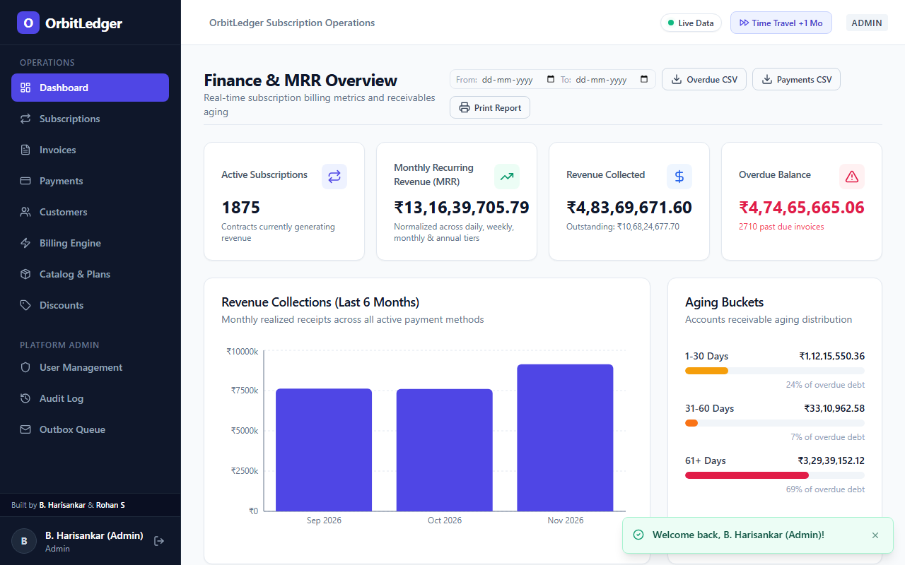
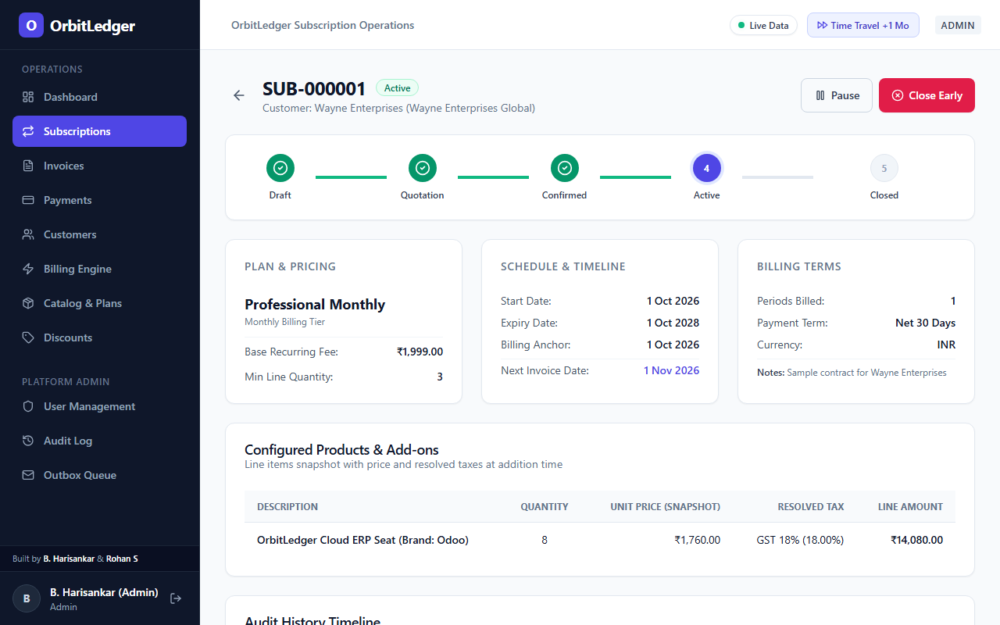
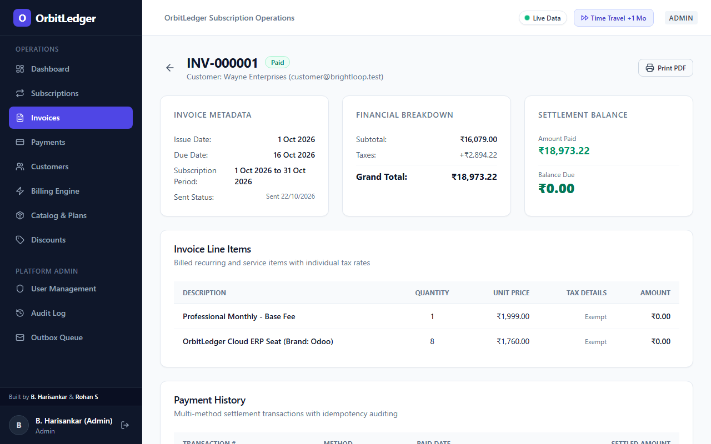
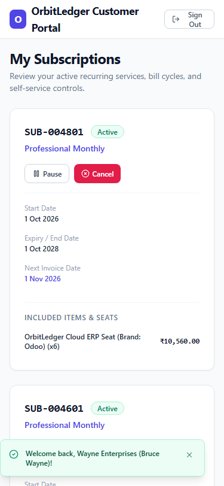
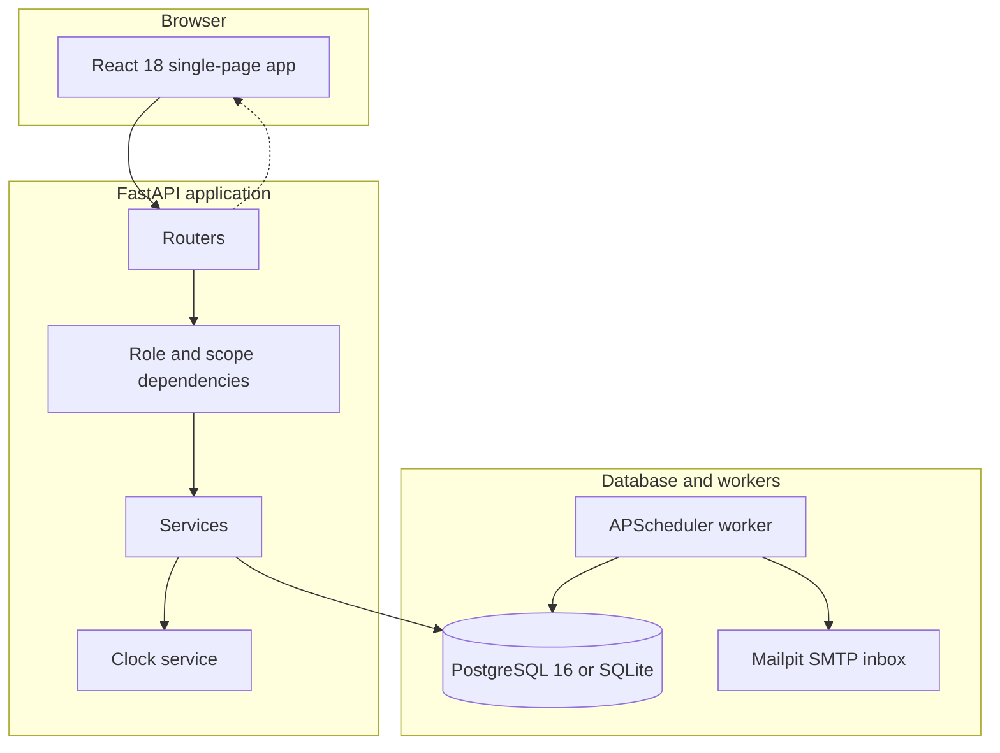

# OrbitLedger Subscription Operations

[](https://github.com/Harisankar005/orbitledger-subscription-ops/actions/workflows/ci.yml)
[](https://www.python.org/)
[](https://fastapi.tiangolo.com/)
[](https://react.dev/)
[](https://www.typescriptlang.org/)
[](https://www.postgresql.org/)

OrbitLedger manages subscription lifecycles, recurring billing, and revenue records. Built with Python 3.12, FastAPI, SQLAlchemy 2.0, PostgreSQL with SQLite fallback, and a React 18 TypeScript single-page client.

> **Built for Brightloop Software:** OrbitLedger is the subscription operations and recurring billing platform, and `brightloop.test` serves as the primary demo tenant domain and organization context.
>
> **Project Builders (Odoo Hackathon):**
> - **B. Harisankar** ([@Harisankar005](https://github.com/Harisankar005)) — System Architecture, Billing Engine, Concurrency & Security, API Services, Database Migrations
> - **Rohan S** ([@rohan1537](https://github.com/rohan1537)) — Frontend Architecture, Operations Console, Customer Portal, Recharts Analytics, Containerization & CI/CD

---

## Quickstart in five commands

Run OrbitLedger locally without cloud services:

```bash
# 1. Clone and enter repository
git clone https://github.com/Harisankar005/orbitledger-subscription-ops.git && cd orbitledger-subscription-ops

# 2. Set up backend environment and copy configuration
cp .env.example backend/.env                 # Windows: copy .env.example backend\.env
cd backend
python -m venv .venv
source .venv/bin/activate                    # Windows: .venv\Scripts\activate
pip install -r requirements.txt

# 3. Run database migrations and seed data
alembic upgrade head
python -m app.seed --small

# 4. Start backend API and scheduler
EMBEDDED_WORKER=true uvicorn app.main:app --host 0.0.0.0 --port 8000 --reload

# 5. In a second terminal, start the frontend client
cd ../frontend
npm install
npm run dev
```

Open the web app at `http://localhost:5173`.

> **Note on Email Outbox:** The local email inbox at `http://localhost:8025` is provided by Mailpit when running with Docker Compose. In this manual setup, all generated emails are safely queued in the transactional outbox and visible inside the application on the admin Outbox page at `http://localhost:5173/admin/outbox`.

---

## How to run the 4-minute demo

For live presentations and hackathon evaluation, follow the step-by-step walkthrough in [**docs/DEMO_SCRIPT.md**](docs/DEMO_SCRIPT.md). It outlines a guided 4-minute path covering:
1. **Overview & Authentication (Min 0-1):** Instant one-click test credentials, Argon2id security, and responsive operations console.
2. **Subscription Lifecycle & Variants (Min 1-2):** Template creation, product variant additions, tax resolution, and lifecycle state-machine progression (`Draft -> Quotation -> Confirmed -> Active`).
3. **Billing Run & Time-Travel Simulation (Min 2-3):** Dry-run forecasting, automated invoice generation with anchor arithmetic, and one-click time-travel clock advancement with confirmation dialog and toast notifications.
4. **Customer Self-Service & Mobile Responsive Portal (Min 3-4):** Mobile card layout at 375px, self-service pause/resume, invoice download, and atomic overpayment prevention.

---

## Application screenshots

| Operations Dashboard | Subscription Lifecycle & Stepper |
|---|---|
|  |  |
| *Real-time MRR, active subscriptions, overdue receivables aging, and 6-month revenue trends.* | *Lifecycle state machine stepper, product lines, tax resolution, payment terms, and audit log.* |

| Prorated Invoicing & Payments | Mobile Customer Portal (375px) |
|---|---|
|  |  |
| *Prorated multi-line discounts, tax breakdown, payment history, and atomic payment recording.* | *Customer self-service portal optimized for mobile viewports with card-based responsive views.* |

---

---

## Seeded demo credentials

The login page includes buttons that fill credentials with one click.

| Role | Email | Password | Access capabilities |
|---|---|---|---|
| Platform admin | `admin@brightloop.test` | `Admin@1234` | All records, user accounts, audit logs, outbox queue |
| Operations staff | `staff1@brightloop.test` | `Staff@1234` | Subscriptions, catalog, billing runs, payments, invoices |
| Customer subscriber | `customer@brightloop.test` | `Customer@1234` | Customer portal, pause, close, invoice printing |

---

## Problem to feature mapping

| Operational problem | Implementation | Verification |
|---|---|---|
| Duplicate billing on retries or concurrent runs | Compound unique constraint `UNIQUE(subscription_id, period_start)` and row locks | `tests/concurrency/test_billing_idempotency.py` checks back-to-back runs create zero duplicate invoices |
| Anchor date drift on month ends | Fixed `billing_anchor` field and `dateutil.relativedelta(months=n)` arithmetic | Anchor tests verify January 31 plus two months lands on March 31 |
| Uncontrolled discount stacking | Rule D-004: best single product discount plus best single subscription discount | `tests/unit/test_discount_rules.py` checks bounds and limits |
| Race conditions on coupon limits | Atomic database update: `UPDATE discount_rules SET used_count = used_count + 1 WHERE used_count < limit` | Concurrency tests verify limit exhaustion |
| Object-level access leaks | Server scopes queries by customer id and returns 404 for unowned rows | `tests/authz/test_authz_matrix.py` checks access control |
| Floating-point rounding errors | Python Decimal type with `ROUND_HALF_UP` and database `Numeric(14,2)` columns | Hypothesis tests check arithmetic invariants across randomized inputs |
| Untracked state changes | Append-only `audit_log` table storing before and after JSON snapshots | Admin UI lists entries and transactions record logs |
| Slow responses during email outages | Transactional outbox table with asynchronous delivery to Mailpit | Worker polls messages and retries failed deliveries |

---

## System architecture



---

## Implementation details

1. **State machine.** Subscriptions use explicit statuses: Draft, Quotation, Confirmed, Active, Paused, and Closed. Validations reject transitions missing product lines or required quantities.
2. **Optimistic concurrency control.** Tables for subscriptions and invoices store a version number. Conflicting updates return HTTP 409.
3. **Clock simulation.** The administration header includes a button to advance time by one month. This tests renewal generation and dunning rules without waiting thirty days.
4. **Database portability.** SQLAlchemy 2.0 models run on SQLite for development and PostgreSQL for production. PostgreSQL deployments use `FOR UPDATE SKIP LOCKED` and advisory locks.
5. **Authentication controls.** Passwords use Argon2id hashing and require nine characters, uppercase letters, lowercase letters, and symbols. Access tokens remain in client memory with a 15-minute lifetime. Refresh tokens use HTTP-only cookies with token rotation. Failed logins trigger a 15-minute lockout after five attempts.

---

## Test coverage and benchmarks

### Automated test suites (100 tests passing)

The project includes 76 backend unit, concurrency, property-based, and authorization tests in pytest, alongside 24 frontend unit and validation tests in Vitest:

```bash
# Backend pytest suite with service coverage
cd backend
pytest -v --cov=app/services tests/

# Frontend Vitest suite & ESLint
cd ../frontend
npm run test
npm run lint
```

Coverage across `app/services`: **91%**
- `services/discount.py`: **99%**
- `services/invoice.py`: **99%**
- `services/catalog.py`: **98%**
- `services/tax.py`: **98%**
- `services/reports.py`: **96%**
- `services/billing.py`: **93%**
- `services/payment.py`: **90%**
- `services/subscription.py`: **88%**
- `services/numbering.py`: **83%**
- `services/auth.py`: **81%**
- `services/idempotency.py`: **81%**

All 76 backend tests pass against an isolated temporary database (`conftest.py` ensures `brightloop.db` is never touched):

```text
tests/authz/test_authz_matrix.py (4 tests) - Staff forbidden from admin actions, staff business ops, customer scoping, unauthenticated rejection
tests/concurrency/test_billing_idempotency.py (13 tests) - Atomic lease claims, duplicate runs create zero, header verification, cross-endpoint scope isolation, stale worker recovery
tests/concurrency/test_payment_and_discount_concurrency.py (2 tests) - Atomic conditional overpayment prevention under parallel threads, atomic discount usage exhaustion
tests/unit/test_auth_and_security.py (7 tests) - Production settings validation, cookie attributes, password strength, account lockout, enumeration resistance, token rotation
tests/unit/test_billing_catchup_and_monthend.py (3 tests) - Catchup cap enforcement, daily catchup bounds, month-end Feb/Mar anchor arithmetic
tests/unit/test_catalog_service.py (5 tests) - Product & variant CRUD, tax & rules CRUD, payment terms, plan CRUD with date constraints, quotation template CRUD
tests/unit/test_core_services_depth.py (8 tests) - Billing catchup, discount deletion & validation, invoice cancellation & voiding, reports MRR & aging buckets, audit trails
tests/unit/test_discount_rules.py (3 tests) - Eligibility & stacking, atomic coupon limit exhaustion, discount bounds
tests/unit/test_draft_edit_and_routes.py (5 tests) - Discount toggle, outbox retry, draft subscription patch, date validation, quotation templates
tests/unit/test_invoices_and_payments.py (6 tests) - Invoice lifecycle & optimistic locking, cancellation, outbox queue, payment validation, partial payments, payment idempotency
tests/unit/test_migration_data_safety.py (1 test) - Non-destructive Alembic migration data preservation across upgrade/downgrade
tests/unit/test_overdue_and_reports.py (2 tests) - Overdue consistency across dashboard/list/CSV, draft invoices excluded from receivables
tests/unit/test_pricing_and_tax.py (3 tests) - Tax resolution order, percent & fixed calculations, prorated discounts Hypothesis invariant
tests/unit/test_state_machine.py (3 tests) - Transition validation gates, illegal transition rejection, optimistic locking
tests/unit/test_subscription_service.py (8 tests) - Plan flags: allow_pause, allow_early_close, allow_renew, min_quantity, availability dates, auto_close_on_end, renew, templates
tests/unit/test_time_travel_endpoints.py (3 tests) - Clock advance, clock reset, clock status reporting
```

### Docker Compose & Time-Travel Demo

To deploy from a completely clean volume:

```bash
# 1. Start all containers with fresh volumes
docker compose down -v && docker compose up --build

# 2. In a separate terminal, seed initial records
docker compose exec api python -m app.seed --small

# 3. Access web client
# Open http://localhost in browser
```

The `api` container automatically executes `alembic upgrade head` before launching Uvicorn, and both `api` (`/api/health`) and `web` containers run integrated Docker healthchecks.

#### Time-travel demo mode
To enable time-travel clock advancement for demonstration:

```bash
DEMO_MODE=true docker compose up
```

When running in demo mode, platform administrators (`admin@brightloop.test`) see a **Time Travel +1 Mo** button in the top navigation bar. Clicking it calls `/api/demo/advance-clock`, advancing the simulated UTC clock by one calendar month and triggering the idempotent billing engine to generate new invoice cycles without waiting 30 days.

### Dataset sizes

- **Small seed (`--small`)**: 20 customers, 6 plans, 35 subscriptions, 62 invoices, and 24 payments. Ideal for live evaluation and rapid local walkthroughs.
- **Full seed (`--full`)**: 200 customers, 6 plans, 5,000 subscriptions, 8,727 invoices, and 3,333 payments spanning all aging brackets (1-30, 31-60, 61+ days overdue).

### Known limitations

1. **Local database dialect**: Local single-process runs use SQLite (`sqlite:///./brightloop.db`), relying on serialized transactions. Multi-worker row-level locking (`SKIP LOCKED`) is active on PostgreSQL 16 in Docker Compose and production environments.
2. **Payment processor simulation**: Payment recording models offline and direct bank transactions (UPI, card, bank transfer, cheque, cash) rather than calling third-party payment gateways (Stripe/Razorpay) via external webhooks.
3. **Outbox email delivery**: Transactional outbox messages are delivered to local Mailpit SMTP (`http://localhost:8025`) for self-contained validation rather than external authenticated SMTP relays.
4. **Client-side routing**: The frontend is a React 18 single-page application using code splitting (`React.lazy`, main bundle: ~248 kB) rather than server-side rendering (SSR).

### Benchmark latency results

Run the 50-iteration benchmark suite:

```bash
python -m app.perf
```

Measured response times on the `--full` seed (p50 and p95):

- `GET /api/reports/summary`: p50: **5.40 ms**, p95: **7.66 ms** (budget: 800 ms) — Aggregates revenue totals, MRR normalization across billing frequencies, customer count, and overdue aging buckets.
- `GET /api/subscriptions?page=1&page_size=20`: p50: **45.90 ms**, p95: **52.37 ms** (budget: 300 ms) — Paginated subscription retrieval with customer relations across 5,000 subscriptions.
- `GET /api/invoices?page=1&page_size=20`: p50: **52.74 ms**, p95: **69.54 ms** (budget: 300 ms) — Paginated invoice listing with payment balance computation across 8,727 invoices.
- `GET /api/customers?search=Acme`: p50: **13.74 ms**, p95: **15.68 ms** (budget: 300 ms) — Case-insensitive indexed search across 200 customer accounts.
- `POST /api/billing/run` (dry run): p50: **80.12 ms**, p95: **80.12 ms** (budget: 40,000 ms) — Scans 5,000 subscriptions, identifies 25 due active subscriptions as of current date, and performs full dry-run invoice line and discount calculations without committing side effects.

---

## Documentation index

- [Architecture and design details](docs/ARCHITECTURE.md)
- [Architectural decision records](docs/DECISIONS.md)
- [Security and threat model](docs/SECURITY.md)
- [Performance benchmark report](docs/PERFORMANCE.md)
- [Live judging demo script](docs/DEMO_SCRIPT.md)
- [Judge questions and answers](docs/JUDGE_QA.md)

---

## Team and ownership matrix

Verified against Git history (`git shortlog -sne --all` and per-author commit inspection):

| Builder | Core Responsibilities | Modules Owned |
|---|---|---|
| **B. Harisankar** ([@Harisankar005](https://github.com/Harisankar005)) | System Architecture, Data Modeling, Recurring Billing Engine, Pricing & Tax Engine, Idempotency & Concurrency, RBAC & Security, Audit Trails, Alembic Migrations, Containerization & CI/CD | `backend/alembic/`, `backend/app/models/`, `backend/app/services/` (billing, tax, discount, numbering, idempotency, auth, reports, audit), `backend/app/routers/` (billing, catalog, customers, discounts, invoices, payments, platform, reports, subscriptions, users), `backend/app/security.py`, `backend/app/seed.py`, `backend/app/perf.py`, `backend/tests/`, `docker-compose.yml`, `.github/workflows/ci.yml` |
| **Rohan S** ([@rohan1537](https://github.com/rohan1537)) | Frontend Architecture, Single-Page Operations Console, Customer Portal, Recharts Analytics, Docker Nginx Reverse Proxy, Customer Self-Service Profile API, Demo Documentation | `frontend/src/` (components, pages, lib, hooks), `frontend/Dockerfile`, `frontend/nginx.conf`, `backend/app/routers/portal.py`, `docs/DEMO_SCRIPT.md` |
