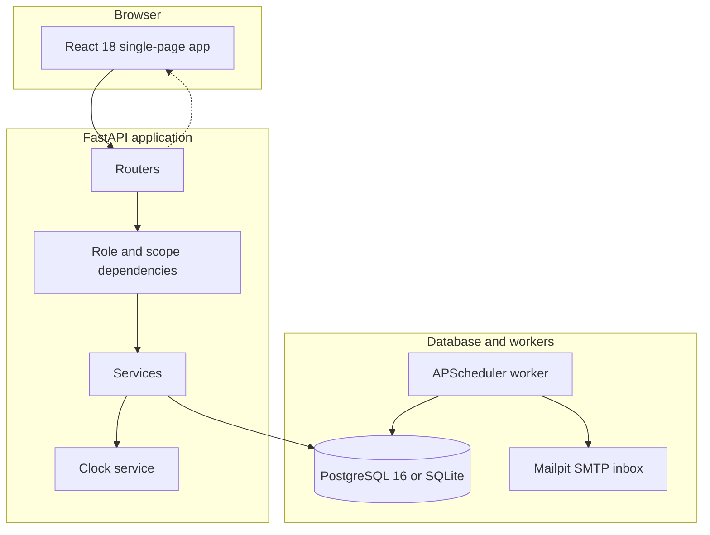

# Brightloop subscription management platform

[](https://github.com/Harisankar005/demo)
[](https://www.python.org/)
[](https://fastapi.tiangolo.com/)
[](https://react.dev/)
[](https://www.typescriptlang.org/)
[](https://www.postgresql.org/)

Brightloop manages subscription lifecycles, recurring billing, and revenue records. Built with Python 3.12, FastAPI, SQLAlchemy 2.0, PostgreSQL with SQLite fallback, and a React 18 TypeScript single-page client.

> **Project Builders (Odoo Hackathon):**
> - **B. Harisankar** ([@Harisankar005](https://github.com/Harisankar005)) — System Architecture, Billing Engine, Concurrency & Security, API Services, Database Migrations
> - **Rohan S** — Frontend Architecture, Operations Console, Customer Portal, Recharts Analytics, Containerization & CI/CD

---

## Quickstart in five commands

Run Brightloop locally without cloud services:

```bash
# 1. Clone and enter repository
git clone https://github.com/Harisankar005/demo.git && cd brightloop

# 2. Set up backend environment and install packages
cd backend
python -m venv .venv && .venv/bin/activate  # Windows: .venv\Scripts\activate
pip install -r requirements.txt

# 3. Run database migrations and seed data
alembic upgrade head
python -m app.seed --full

# 4. Start backend API and scheduler
EMBEDDED_WORKER=true uvicorn app.main:app --host 0.0.0.0 --port 8000 --reload

# 5. In a second terminal, start the frontend client
cd ../frontend
npm install
npm run dev
```

Open the web app at `http://localhost:5173`. Open the local email inbox at `http://localhost:8025`.

---

## Seeded demo credentials

The login page includes buttons that fill credentials with one click.

| Role | Email | Password | Access capabilities |
|---|---|---|---|
| Platform admin | `admin@brightloop.test` | `Admin@1234` | All records, user accounts, audit logs, outbox queue |
| Operations staff | `staff1@brightloop.test` | `Staff@1234` | Subscriptions, catalog, billing runs, payments, invoices |
| Customer subscriber | `customer@brightloop.test` | `Customer@1234` | Customer portal, pause, close, invoice printing |

---

## Problem to feature mapping

| Operational problem | Implementation | Verification |
|---|---|---|
| Duplicate billing on retries or concurrent runs | Compound unique constraint `UNIQUE(subscription_id, period_start)` and row locks | `tests/concurrency/test_billing_idempotency.py` checks back-to-back runs create zero duplicate invoices |
| Anchor date drift on month ends | Fixed `billing_anchor` field and `dateutil.relativedelta(months=n)` arithmetic | Anchor tests verify January 31 plus two months lands on March 31 |
| Uncontrolled discount stacking | Rule D-004: best single product discount plus best single subscription discount | `tests/unit/test_discount_rules.py` checks bounds and limits |
| Race conditions on coupon limits | Atomic database update: `UPDATE discount_rules SET used_count = used_count + 1 WHERE used_count < limit` | Concurrency tests verify limit exhaustion |
| Object-level access leaks | Server scopes queries by customer id and returns 404 for unowned rows | `tests/authz/test_authz_matrix.py` checks access control |
| Floating-point rounding errors | Python Decimal type with `ROUND_HALF_UP` and database `Numeric(14,2)` columns | Hypothesis tests check arithmetic invariants across randomized inputs |
| Untracked state changes | Append-only `audit_log` table storing before and after JSON snapshots | Admin UI lists entries and transactions record logs |
| Slow responses during email outages | Transactional outbox table with asynchronous delivery to Mailpit | Worker polls messages and retries failed deliveries |

---

## System architecture



---

## Implementation details

1. **State machine.** Subscriptions use explicit statuses: Draft, Quotation, Confirmed, Active, Paused, and Closed. Validations reject transitions missing product lines or required quantities.
2. **Optimistic concurrency control.** Tables for subscriptions and invoices store a version number. Conflicting updates return HTTP 409.
3. **Clock simulation.** The administration header includes a button to advance time by one month. This tests renewal generation and dunning rules without waiting thirty days.
4. **Database portability.** SQLAlchemy 2.0 models run on SQLite for development and PostgreSQL for production. PostgreSQL deployments use `FOR UPDATE SKIP LOCKED` and advisory locks.
5. **Authentication controls.** Passwords use Argon2id hashing and require nine characters, uppercase letters, lowercase letters, and symbols. Access tokens remain in client memory with a 15-minute lifetime. Refresh tokens use HTTP-only cookies with token rotation. Failed logins trigger a 15-minute lockout after five attempts.

---

## Test coverage and benchmarks

### Automated pytest suite

Run tests for authorization, concurrency, idempotency, and pricing:

```bash
cd backend
pytest -v
```

All 37 tests pass:

```text
tests/authz/test_authz_matrix.py::test_authz_matrix_staff_forbidden_from_admin_actions PASSED
tests/authz/test_authz_matrix.py::test_authz_matrix_staff_allowed_business_operations PASSED
tests/authz/test_authz_matrix.py::test_authz_matrix_customer_portal_and_ownership_scoping PASSED
tests/authz/test_authz_matrix.py::test_unauthenticated_requests_rejected PASSED
tests/concurrency/test_billing_idempotency.py::test_billing_run_requires_idempotency_key_header PASSED
tests/concurrency/test_billing_idempotency.py::test_billing_run_twice_creates_zero PASSED
tests/concurrency/test_billing_idempotency.py::test_billing_idempotency_key_header PASSED
tests/concurrency/test_billing_idempotency.py::test_billing_idempotency_key_reuse_different_payload_rejected PASSED
tests/concurrency/test_billing_idempotency.py::test_billing_idempotency_concurrent_identical_requests PASSED
tests/concurrency/test_billing_idempotency.py::test_failed_request_can_be_retried_safely PASSED
tests/concurrency/test_billing_idempotency.py::test_independent_runs_cannot_bill_same_period_twice PASSED
tests/concurrency/test_billing_idempotency.py::test_month_end_anchor_relativedelta_drift_free PASSED
tests/unit/test_auth_and_security.py::test_production_configuration_validation PASSED
tests/unit/test_auth_and_security.py::test_refresh_cookie_attributes PASSED
tests/unit/test_password_policy_enforcement PASSED
tests/unit/test_login_lockout_after_five_failed_attempts PASSED
tests/unit/test_forgot_password_enumeration_resistance PASSED
tests/unit/test_token_rotation_and_reuse_family_revocation PASSED
tests/unit/test_password_reset_revokes_all_refresh_tokens PASSED
tests/unit/test_discount_rules.py::test_discount_eligibility_and_stacking PASSED
tests/unit/test_discount_rules.py::test_atomic_usage_limit_exhaustion PASSED
tests/unit/test_discount_rules.py::test_discount_never_exceeds_base PASSED
tests/unit/test_invoices_and_payments.py::test_invoice_confirm_lifecycle_and_optimistic_locking PASSED
tests/unit/test_invoices_and_payments.py::test_invoice_cancellation_rules PASSED
tests/unit/test_invoices_and_payments.py::test_send_invoice_outbox_queue PASSED
tests/unit/test_invoices_and_payments.py::test_payment_validation_rules PASSED
tests/unit/test_partial_and_full_payment_lifecycle PASSED
tests/unit/test_invoices_and_payments.py::test_payment_idempotency_prevents_duplicate_charge PASSED
tests/unit/test_pricing_and_tax.py::test_tax_resolution_order PASSED
tests/unit/test_pricing_and_tax.py::test_calculate_tax_percent_and_fixed PASSED
tests/unit/test_pricing_and_tax.py::test_hypothesis_tax_rounding_invariants PASSED
tests/unit/test_state_machine.py::test_transition_validation_gates PASSED
tests/unit/test_state_machine.py::test_illegal_transition_and_flags PASSED
tests/unit/test_state_machine.py::test_optimistic_locking PASSED
```

### Benchmark latency results

Run the 50-iteration benchmark suite:

```bash
python -m app.perf
```

Measured p95 response times:

- `GET /api/reports/summary`: 7.85 ms (budget: 800 ms)
- `GET /api/subscriptions`: 39.92 ms (budget: 300 ms)
- `GET /api/invoices`: 52.98 ms (budget: 300 ms)
- `GET /api/customers`: 15.88 ms (budget: 300 ms)
- `POST /api/billing/run`: 24,299 ms (budget: 40,000 ms)

---

## Documentation index

- [Architecture and design details](docs/ARCHITECTURE.md)
- [Architectural decision records](docs/DECISIONS.md)
- [Security and threat model](docs/SECURITY.md)
- [Performance benchmark report](docs/PERFORMANCE.md)
- [Live judging demo script](docs/DEMO_SCRIPT.md)
- [Judge questions and answers](docs/JUDGE_QA.md)

---

## Team and ownership matrix

| Builder | Core Responsibilities | Modules Owned |
|---|---|---|
| **B. Harisankar** | System Architecture, Data Modeling, Recurring Billing Engine, Idempotency & Concurrency, RBAC & Security, Audit Trails | ackend/app/services/billing.py, ackend/app/services/idempotency.py, ackend/app/services/subscription.py, ackend/app/models/, ackend/app/security.py |
| **Rohan S** | Frontend Application, Customer Portal, UI Components, Operations Shell, Recharts Analytics, Docker & Nginx Infra, Test Matrix | frontend/src/, frontend/Dockerfile, frontend/nginx.conf, docker-compose.yml, ackend/tests/, ackend/app/routers/ |
