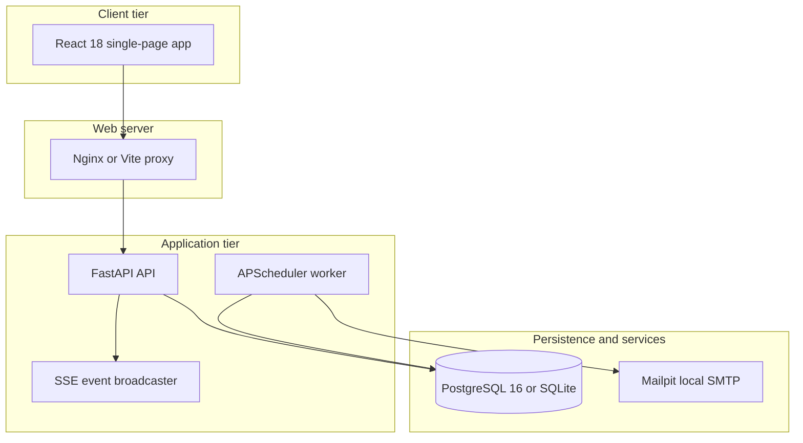
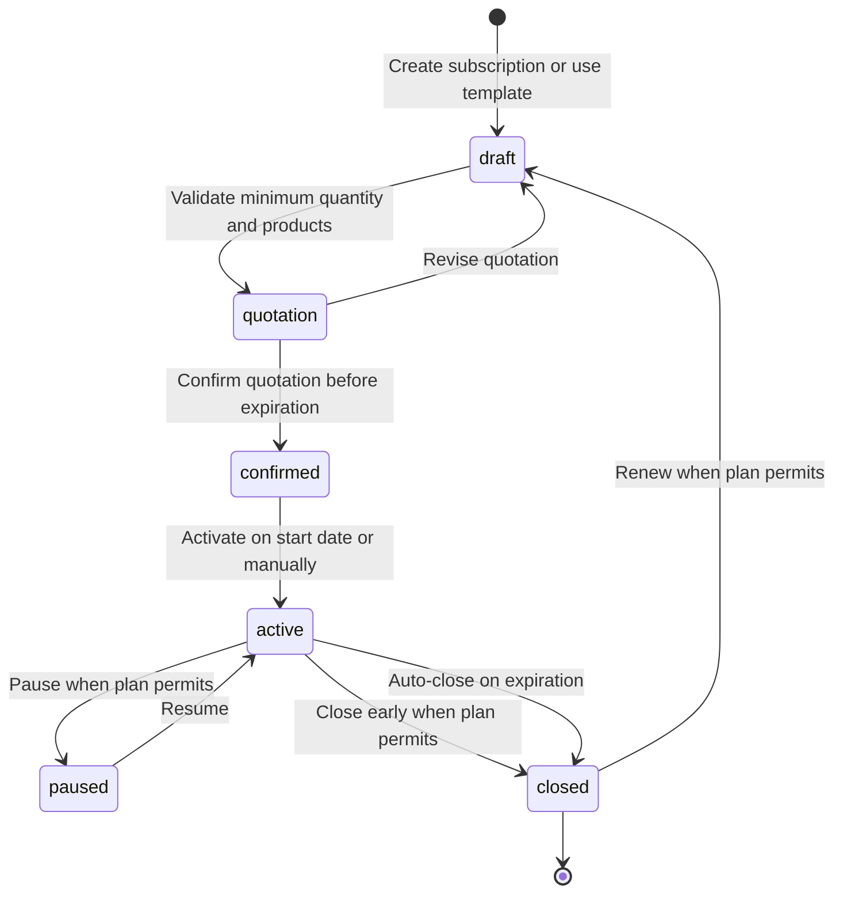
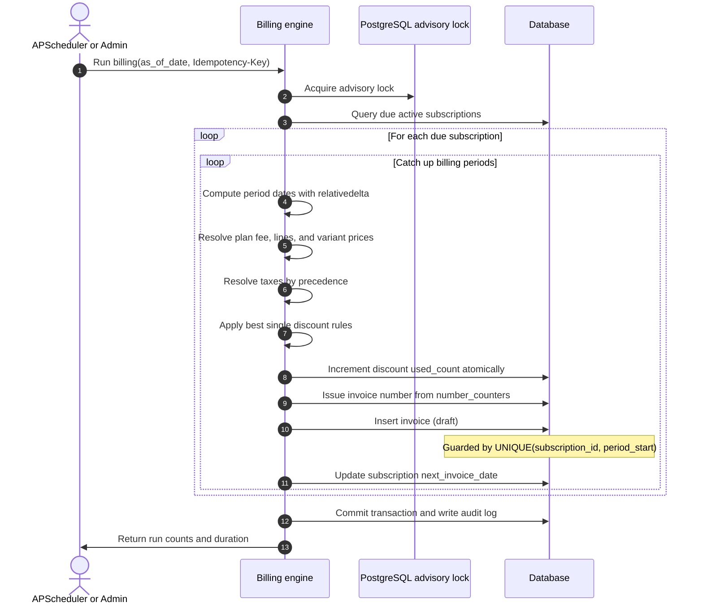

# Brightloop system architecture

## 1. High-level topology

## 2. Layered software architecture

1. **Routers.** `app/routers/` handles HTTP transport: parameter deserialization, query parsing, status code selection, and response serialization. Routers contain no business rules or transaction management.
2. **Services.** `app/services/` executes business rules and manages database transactions. Services enforce financial math using `Decimal`, state machine transitions, discount rules, tax resolution order, billing runs, and audit log writes.
3. **Models and repositories.** `app/models/` defines declarative SQLAlchemy 2.0 mapped models, database constraints, and indexes.

## 3. Subscription lifecycle state machine

## 4. Billing engine and idempotency flow

## 5. Security and authentication design

1. **Password security.** The system hashes passwords using Argon2id. Passwords require nine characters, uppercase letters, lowercase letters, and symbols.
2. **Session management.** Short-lived access tokens stay in client memory for fifteen minutes. Refresh tokens travel in cookies marked `HttpOnly`, `SameSite=Strict`, and `Secure` in production. Refreshing a token consumes it and returns a new token in the same family. Using a revoked token invalidates the entire family.
3. **Role-based access.** The server guards administrative routes using role dependencies (`require_roles`). Customer portal endpoints filter queries by the authenticated user customer id and return 404 for unowned records.
