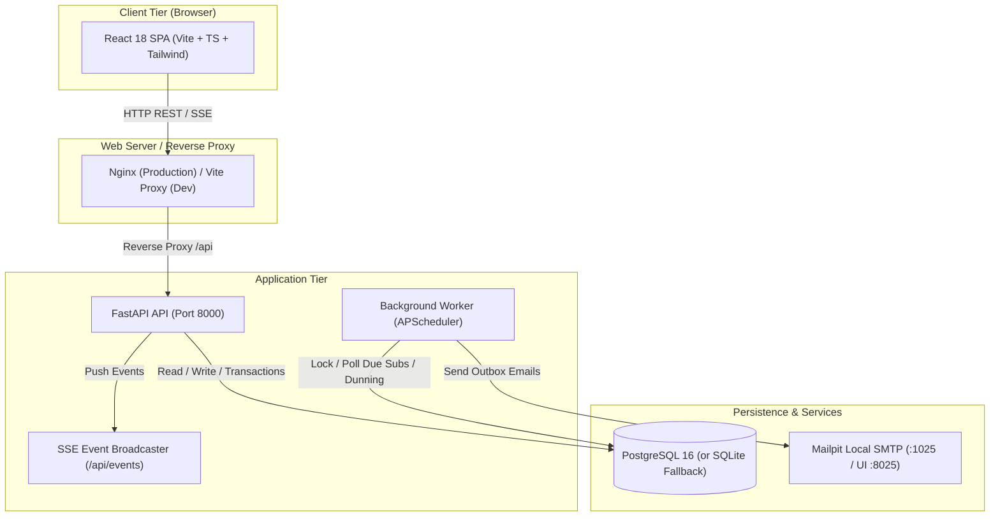
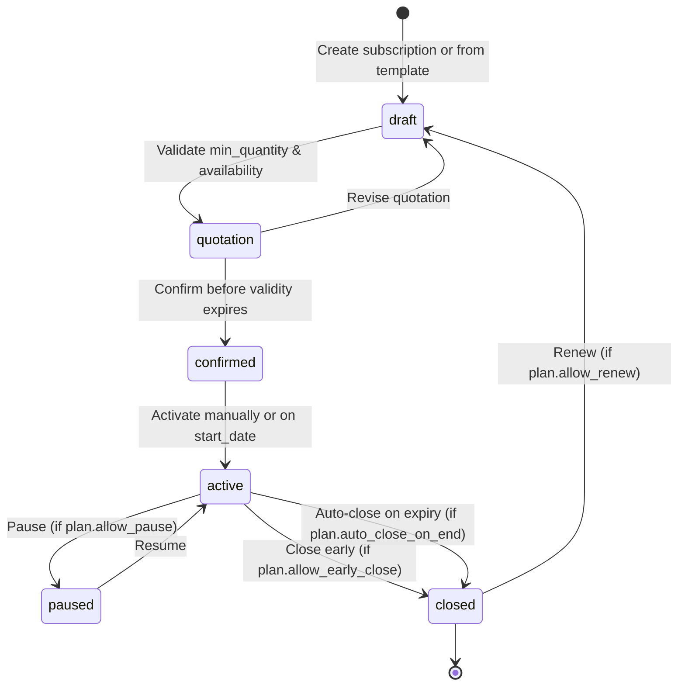
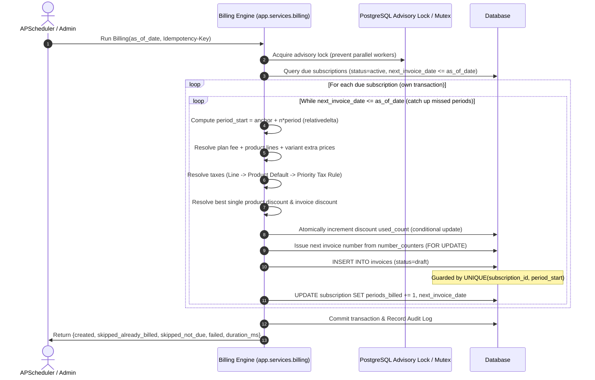

# Brightloop System Architecture

## 1. High-Level Topology

## 2. Layered Software Architecture

Brightloop strictly enforces a 3-tier backend design pattern:

1. **Routers (`app/routers/*`)**:
   - HTTP transport only: parameter deserialization, query parsing, status code selection, response serialization.
   - Zero business rules or transaction management.
2. **Services (`app/services/*`)**:
   - The authoritative core of the platform.
   - Manages database transaction boundaries (`session.commit()` / `session.rollback()`).
   - Implements invariants: pricing math with `Decimal`, state machine transitions, discount eligibility, tax resolution order, billing runs, and audit trail emission.
3. **Models & Repositories (`app/models/*`, `app/repositories/*`)**:
   - Declarative SQLAlchemy 2.0 mapped models.
   - Database constraints (CHECK, UNIQUE, Foreign Keys, Indexes).

## 3. Subscription Lifecycle State Machine

## 4. Billing Engine & Idempotency Pipeline

## 5. Security & Authentication Architecture

- **Password Security**: Argon2id hashing algorithm with standard parameters. Password policy requiring minimum 9 characters, uppercase, lowercase, and special characters.
- **Session Architecture**:
  - Stateless JWT access tokens (15-minute validity) stored strictly in client memory.
  - Refresh tokens stored in encrypted `httpOnly`, `Secure`, `SameSite=Strict` cookies.
  - **Token Family Rotation**: Every refresh generates a new token in the token family. Attempted reuse of a previous token triggers instant revocation of the entire family.
- **Role-Based Access Control (RBAC)**:
  - Three distinct roles: `admin`, `staff`, `customer`.
  - Server-enforced dependency injection via `require_roles()`.
  - Ownership scoping: customer queries filter strictly by `customer.user_id == current_user.id`; unauthorized access returns `404 Not Found` to prevent IDOR scanning.
